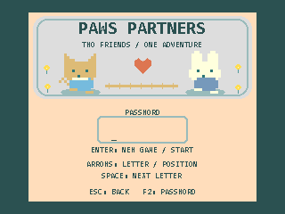
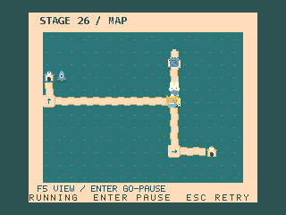
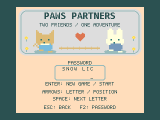

# PAWS PARTNERS

**ネコとうさぎを、それぞれの家へ。 / Guide two friends to their own homes.**

A 50-stage cooperative puzzle game for **MSX2 and later**. Place TURN and WAIT chips, push crates, hop over holes, and coordinate switches. There is no time limit.

ネコとうさぎの得意技と、到着する順番を考えるパズルです。方向転換やWAITを配置してから二匹を出発させます。時間制限なし・全50面。

## Download / ダウンロード

- **[Latest release / 最新版](https://github.com/kanon-ai/PAWS-PARTNERS/releases/latest)** — ROM and manuals in one ZIP.
- [ROM directly / ROM単体](rom/PAWS-PARTNERS-MSX2.rom) — 1 MiB, ASCII8.
- **[日本語マニュアル](docs/MANUAL.ja.md)** / **[English manual](docs/MANUAL.en.md)**
- [BGM付き紹介動画 / Music trailer](media/PAWS-PARTNERS-X-BGM.mp4) — approximately 56 seconds, fictional promotional stages, no campaign solutions. Music is laid continuously over the video; the actual game's title screen is silent.

## Requirements / 動作条件

MSX2 or later, **64 KiB RAM / 64 KiB VRAM**, keyboard, and a device or emulator supporting **1 MiB ASCII8** ROMs. MSX Turbo R runs the game in Z80 mode. No enhanced VDP is required. A 512 KiB-only flash cartridge is insufficient.

MSX2以降、メインRAM 64KiB・VRAM 64KiB以上、キーボード操作です。拡張VDPは不要です。1MiBのASCII8 ROMに対応する環境を使用してください。

**OpenMSX-tested; physical hardware not yet verified. / openMSXで確認済み・実機未検証。**

## Quick start / まず遊ぶ

1. At the title, leave the password blank and press **Enter**. / 合言葉を空欄にしてEnter。
2. Select a placement spot with **Left/Right**, cycle its chip with **Space**. / 左右で場所を選び、Spaceで配置。
3. Press **Enter** to start both friends. Use **Esc** to retry. / Enterで出発、Escで再挑戦。
4. Bring both friends to their matching homes. / 二匹をそれぞれの家に帰しましょう。

**Planning: Up places a solution hint; Down removes all chips.**
配置中の上キーは、その場所に正解チップを置くヒントです。下キーは全消去です。

Read the manuals for WAIT, FLIP, large-map browsing, retries, and stage passwords.
ミスしても残機は減りません。詳しい仕掛け・スクロール・合言葉の使い方はマニュアルをご覧ください。

## Status / 公開状況

**v0.2.6 — Live overview / 全体マップで進行**

F5の全体マップでも、ネコとうさぎの移動や箱・ゲートなどの変化を見ながら進行できるようになりました。Enterで開始／一時停止／再開、実行中はEscで配置を残してやり直せます。F5で通常画面へ切り替えても状態を保ちます。全体マップ下部の案内文字が欠ける問題も修正しました。ステージ内容・難易度・合言葉は変更していません。

The F5 overview now shows both friends moving and updates crates, gates and other mechanisms as the run progresses. Enter starts, pauses or resumes; Esc during a run retries with placed chips preserved. F5 switches views without resetting progress. Fixed clipped text in the overview footer. Stages, difficulty and passwords are unchanged.

[全体マップの動作動画 / Live overview preview](media/PAWS-PARTNERS-F5-Live-Preview.mp4) — 21 seconds, actual gameplay and audio. Contains part of stage 26.

F1のHELP最下段で現在の面番号とパスワードを確認できます。F1またはEscで元の状態に戻ります。

Press F1 to see the current stage and password at the bottom of HELP; F1 or Esc returns to play.

文字とTURN矢印を見やすくし、クリア時に二匹が喜ぶ動きと短いPSGフレーズを追加しました。CLEAR / NO WAYを中央の小窓に表示します。v0.2.2からステージ内容・順序・合言葉は変更していません。

Improved small text and TURN arrows, a happy hop at ordinary stage clears, a one-shot PSG clear jingle, and centered CLEAR / NO WAY windows. Stages, order and passwords are unchanged from v0.2.2.

配置チップが仕掛けと重なるマスでも、箱・PAD・扉・スイッチ・家・固定方向床の絵と識別表示が残り、現在の開閉・作動状態を確認できます。
Mechanism icons and identifiers remain visible beneath chips, including current gate and switch states.

Stages with similar layouts have been revisited to give each puzzle a more distinct cooperative challenge. New pressure, inverse-pressure, two-PAD, phase-switching, one-shot and fragile-floor mechanisms combine with route and timing choices. Later stages include larger maps and a demanding final challenge tier.

類似した構成のステージを見直し、全50面を協力・経路・順番・タイミングを考える構成に再設計しました。PAD・!A・2A・SWAP・ONCE・WEAKなどを組み合わせ、終盤には超高難易度を目指した問題を用意しています。難易度は設計上の目安です。

- Esc cancels a run while keeping placed chips. / Escで実行を中断し、配置を残して再挑戦できます。
- Hide selection frames during execution and skip unchanged terrain redraws to reduce flicker. / 実行中の白枠を非表示にし、変化しない仕掛けの再描画を抑制。
- Gates remain visibly open until an admitted friend passes through; 2A lamps show the occupied PAD count. / 通過中の扉表示と2Aランプを改善しました。
- [日本語ヒントブック](docs/HINTBOOK.ja.md) / [English technique hints](docs/HINTBOOK.en.md) — techniques, not stage solutions.
- [新しい仕掛けのダイジェスト / New mechanisms digest](media/PAWS-PARTNERS-New-Mechanisms-Digest.mp4) — 45 seconds, four fictional stages shown once each, actual gameplay audio including the clear jingle.

Stage contents and order have changed. Old passwords may not correspond to the same puzzle; starting from stage 1 is recommended. Source data contains solutions.

面内容と順序を変更しています。旧版の合言葉で同じ問題に戻れるとは限らないため、1面からのプレイをおすすめします。ソース・面データには解法が含まれます。

There is no automatic save; write down stage-clear passwords. Joystick controls are not implemented. Continuously moving loops are not automatically detected: press Esc to retry.

進行状況は合言葉で再開できます。自動セーブ・ジョイスティック操作は未実装です。動き続けるループはEscでやり直してください。

## Music / 音楽

**Pixel Party** — music supplied by kanon-ai, produced through a Suno (Premium) → PSG → AI music editor workflow. Two melodic PSG channels and percussion, with short sound-effect borrowing on channel C.

ゲーム中はループし、タイトル／合言葉・行き詰まり画面では停止します。クリア時は **Moonlit Gem - Clear Jingle B**（kanon-ai提供）を一度だけ再生し、次の面でBGMを再開します。

At stage clear, **Moonlit Gem - Clear Jingle B**, supplied by kanon-ai, plays once. BGM resumes on the next stage.

## Development / 開発

[Build instructions and test evidence / ビルドと検証](docs/BUILD.md)

The current ROM passed exact 100-frame PSG jingle comparisons, clear-window restoration, and final-stage transitions on both openMSX profiles (MSX2 and TurboR), plus MSX2 music, cancellation and overlay checks. See build notes for tested hashes and scope. Physical hardware remains unverified.

修正した表示処理はMSX2・TurboR設定で各40,897項目と追加検証を通過しました。最終の文字サイズ調整は画像のみの差分で、実描画データ480項目の照合も通過しています。実機未確認です。

## License and disclaimer / ライセンス・免責

[MIT License](LICENSE) · [Credits / 素材の表記](CREDITS.md) · **[Disclaimer / 免責事項](DISCLAIMER.md)**

Free prototype, provided **as is, without warranty**. Bug reports are welcome, but responses, fixes, and future updates are not guaranteed.

無償公開の試作版・無保証です。不具合報告をいただいても、返信・修正・今後の更新を保証できません。
BIOS・エミュレーター本体・書き込みツールは同梱しません。

## Expert Version / 高難易度版

[Expert版・新作50面](expert/README.md) — [ROM](expert/rom/PAWS-PARTNERS-EXPERT-MSX2.rom)、[日本語マニュアル](expert/docs/MANUAL-ja.md) / [English manual](expert/docs/MANUAL-en.md)、[日本語ヒントブック](expert/docs/TECHNIQUE-GUIDE-ja.md) / [English hint book](expert/docs/TECHNIQUE-GUIDE-en.md)。ノーマル版とは別ディレクトリで配布しています。A separate edition; Normal files are unchanged.
