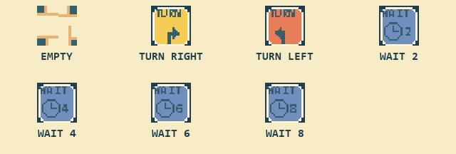
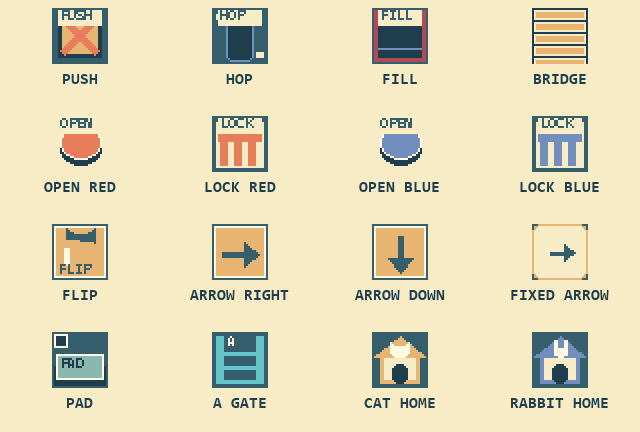
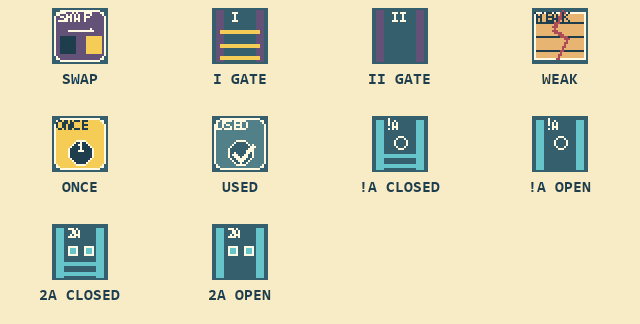

# PAWS PARTNERS: English manual

> v0.2.0: redesigned 50-stage campaign. Tested on MSX2 and TurboR profiles in openMSX; physical hardware remains unverified.

[日本語](MANUAL.ja.md) · [Home / download](../README.md)

Arrange a path and guide **both the cat and the rabbit to their own homes**.
There is no time limit. Plan first, start the two friends, and retry as often as you like.
The game has 50 stages, including larger maps and puzzles about the order in which the friends arrive.

## Starting the game

- MSX2 or later, at least 64 KiB main RAM and 64 KiB VRAM.
- The ROM is **1 MiB, ASCII8**. Select ASCII8 in your emulator if automatic detection fails.
- A physical cartridge must support a 1 MiB ASCII8 ROM. A 512 KiB-only cartridge is not sufficient.
- Use the keyboard. Joystick controls are not implemented.
- On MSX Turbo R, the game runs in Z80 mode. No enhanced VDP is required.
- Leave the password blank and press **Enter** to start stage 1.

Testing has been performed in openMSX. Physical hardware operation has not been verified.

## Your first puzzle

1. Check the starting arrow beneath each friend and find their homes.
2. Use **Left/Right** to select a placement spot, then **Space** to cycle its chip.
3. Press **Enter**. Both friends start together and normally walk straight ahead.
4. Once both reach their own homes, the stage is clear. Press **Enter** for the next stage.

**Spotted a mistake? Press Esc to cancel the run.** Your placed chips stay in place while both friends and the mechanisms return to their starting state. Adjust your setup and press Enter to try again. Esc also works while paused.

The pointed-ear symbol marks the cat's home; the long-ear symbol marks the rabbit's home.
Swapping their destinations does not count as a clear. Once one friend is home, the other continues alone.
A friend that has arrived home no longer blocks the path. The other friend can cross that home tile if the route continues through it.
The blue rocket beside the rabbit's home is scenery, not a mechanism.

**MIN** is the minimum number of occupied placement spots. It is a reference, not a limit.
You can place chips only at the predefined spots, not on every floor tile.

## Placeable chips

Choose from the chips below, or leave the spot empty. WAIT is available only in stages that offer it.

|Chip|Effect|
|---|---|
|EMPTY|Keep walking in the same direction.|
|Right TURN|Turn 90 degrees **to the character's right relative to its incoming direction**. This does not necessarily mean screen-right.|
|Left TURN|Turn 90 degrees to the character's left relative to its incoming direction.|
|WAIT 2 / 4 / 6 / 8|Wait at this spot for the indicated number of movement beats, then continue in the same direction. These numbers are not seconds.|

Space cycles only through chips available in the current stage.
The usual order is Empty → Right TURN → Left TURN. In supported stages, WAIT 2 → 4 → 6 → 8 follow.
Both friends use the same placed chips. Returning to a WAIT spot makes the character wait again.

One WAIT beat is the time it takes to walk one ordinary tile.
Pausing, opening help, or opening the overview also freezes the countdown. A longer wait is not always better.

## Built-in mechanisms

Chips stay on their squares when crates move. A rabbit does not activate a chip
on a square it jumps over; it activates the chip where it lands. Where a chip
shares a mechanism, the lower label identifies the floor, such as PAD or WEAK.

These are part of the stage, not tools you place with Space.

|Label / appearance|Effect|
|---|---|
|PUSH / wooden crate|**Only the cat** can push a crate one tile forward. If its destination is blocked, the cat waits. Pushing a crate into a small or large hole creates a bridge.|
|HOP / small hole|**Only the rabbit** can jump across a one-tile hole. If the landing spot is blocked, it waits before the hole.|
|FILL / large hole|Neither friend can cross it until the cat fills it with a crate.|
|Bridge|Both friends can cross. It stays in place for the current attempt.|
|OPEN / round switch|Either friend can activate it to open LOCK gates of the matching color. Gates stay open for that attempt.|
|LOCK / gate|Opened by the matching reddish or blue OPEN switch. A closed gate makes the approaching character wait.|
|FLIP / toggle switch|**Each time the cat steps on it**, the linked arrow floors change direction. The rabbit does not activate it.|
|Large arrow floor|Sets the arriving character's direction to **screen-right or screen-down**, as shown. FLIP switches toggle right → down → right…|
|Stone / no path|Cannot be crossed.|
|PAD / pressure plate|A friend or crate must remain on it to hold the cyan A gates open. Any linked PAD can supply the weight. Moving the weight away closes the gates unless another PAD is held.|
|!A gate / empty-circle symbol|The opposite of an A gate: it opens only when **all PADs are clear of both friends and crates**. Any occupied PAD closes it. A friend that has already started crossing completes that move even if the gate closes.|
|Cyan A gate|Opens only while a PAD is held. It does not crush a friend already crossing it.|
|2A / cyan gate with two marks|Opens only while **at least two PADs are held at the same time**. Crates and friends can supply the weights in any combination. It closes with fewer than two occupied PADs; a friend already crossing completes that move.|
|Fixed arrow painted on the path|Sets the arriving friend's direction as shown. Unlike the orange FLIP arrows, it does not change. An arrow may share a PAD or blue switch/gate tile.|
|SWAP / purple switch|**Either friend activates it on every arrival.** It exchanges the open and closed states of I and II gates. Initially I is closed and II is open. This circuit is independent of red/blue OPEN and FLIP.|
|I and II gates|Matching gates change together. One group is open while the other is closed. A closed gate makes a friend wait before it.|
|WEAK / cracked floor|Both friends can initially walk on it. When a friend leaves it, it becomes a small hole. Only the rabbit can jump across the hole, but the cat can fill it with a crate to make a bridge. Retry restores the original floor.|
|ONCE / yellow one-shot switch|The first friend to arrive exchanges the same I/II gate states as SWAP, once only. It then reads USED. Both friends can still cross it, but later arrivals do not change the gates. Retry restores ONCE.|

A, !A, 2A, I and II gates stay visibly open until an admitted friend finishes passing through. Entry for the next friend still depends on the current condition. The two lamps on a 2A gate show the current occupied PAD count: no lamps for zero, one lamp for one, and both lamps for two or more, including while a friend is passing through.

Crates can be left on a PAD, then pushed off it later. Filling a hole consumes the crate. A blue B switch/gate works like the existing blue OPEN/LOCK pair. Leaving a placement spot empty is a valid choice.
Crates can be pushed onto plain paths, bridges, PADs without arrows, or holes.
They cannot push another crate along, or be pushed onto switches, gates, WEAK floors, or other special tiles.

An arrow floor uses its direction **at the moment the character arrives**. Flipping it after a character has left does not change that character's earlier decision.
Linked arrow floors share one toggle state. Use routes and WAIT chips to control arrival order when switches are activated more than once.
The friends cannot pass through each other, so one may need to wait for the other to move away.

## Controls

|Situation|Key|Action|
|---|---|---|
|Planning|Left / Right|Select a placement spot; change the displayed page when necessary.|
|Planning|Space|Cycle the selected spot's chip.|
|Planning|Up|**Place the authored solution chip at the selected spot.** This hint changes the placement; it is not just a text hint.|
|Planning|Down|Remove all placed chips.|
|Planning|Enter|Start both friends.|
|Running|Enter|Pause / resume.|
|Running, large maps|Arrow keys|Show the left / right or upper / lower page and disable automatic following. The friends keep moving if the game is not paused.|
|Normal play|Esc|Reset the attempt while keeping placed chips.|
|Stuck screen|Enter / Esc|Retry / return to the title.|
|After a clear|Enter|Next stage; return to stage 1 after the final clear.|
|Normal play|F1|Open / close illustrated English help. Movement stops while it is open. Esc also closes help.|
|Normal play|F2|Open the title / password screen.|
|Large maps|F3|Cycle through the available pages. This pauses a running attempt; press Enter to resume.|
|Normal play|F4|Switch automatic following between cat and rabbit. Restore following after manual browsing.|
|Normal play|F5|Open / close the **initial-layout** overview. Movement stops while it is open.|

Large stages can have up to 16×12 tiles, shown in 8×6 pages. A 16×6 stage uses two side-by-side pages, an 8×12 stage uses two stacked pages, and a 16×12 stage uses four pages.
You can also use F5 while planning your placements, then press F5 again to return.

**The F5 overview does not show placed chips, the current positions of moved crates, or the current gate states.** Browse the normal left/right and upper/lower views to inspect the live situation.
Page redraws may cause a brief visual pause.

## Waiting and retrying

A blocked friend waits in place. It can continue when the other friend builds a bridge, opens a gate, or clears the way.
When neither friend can move and neither has a movement or WAIT countdown pending, the game displays **NO WAY FORWARD**.

- **Enter:** retry with your chip placements retained.
- **Esc:** return to the title.

A retry restores both friends, crates, holes, gates, arrow switches, and WAIT counters to their initial state.
Continuously moving loops are not automatically detected. Use Esc to return to planning if this happens.
There are no lives or time limits.

## Passwords

Each stage clear shows a pair of English words. Write them down.
Enter the password at the title or through F2 to replay **the stage you just cleared**, not the next stage.

- Up / Down: select a letter
- Left / Right: move the input position
- Space: next input position
- Enter: confirm; a blank password starts stage 1
- Esc: return to the game

Passwords replace a progress save. They do not save placed chips or an attempt in progress.

## Music

The PSG arrangement of “Pixel Party” loops during planning, movement, pause, help, overview, and stage-clear screens.
It stops at the title/password and stuck screens, then restarts from the beginning when you return.

## When you would like a hint

If you would like help with your approach, open only the sections you need in the separate [hint book](HINTBOOK.en.md). It does not list stage solutions.

## Terms

This is a free prototype, provided without warranty. Compatibility with every machine, cartridge, or emulator is not guaranteed.
Bug reports are welcome, but replies, fixes, and future updates are not promised.
See [LICENSE](../LICENSE), [DISCLAIMER](../DISCLAIMER.md), and [CREDITS](../CREDITS.md).
