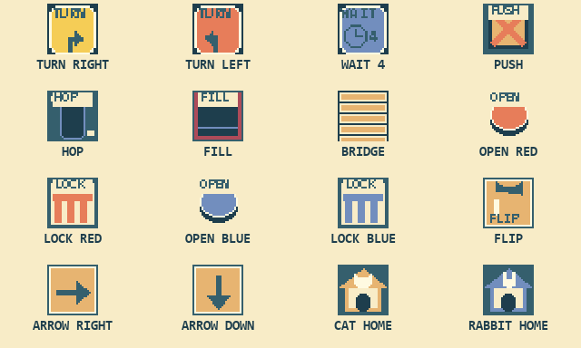

# PAWS PARTNERS：日本語マニュアル

[English](MANUAL.en.md) · [トップ／ダウンロード](../README.md)

ネコとうさぎの道を整え、**二匹をそれぞれの家へ帰す**パズルです。
時間制限はありません。配置を考えてから実行し、うまくいかなければ何度でもやり直せます。
全50面。後半には広いマップと、二匹の到着順を考える仕掛けが登場します。

## 起動

- MSX2以降、メインRAM 64KiB以上、VRAM 64KiB以上。
- ROMは **1MiB・ASCII8** です。エミュレーターでは必要に応じてASCII8を指定してください。
- 実機用カートリッジは、1MiBのASCII8 ROMに対応するものが必要です。512KiB専用のものには収まりません。
- キーボードで操作します。ジョイスティック操作は実装していません。
- Turbo RでもZ80モードで動作します。拡張VDPは不要です。
- タイトルの合言葉を空欄にして **Enter** を押すと1面から始まります。

動作確認はopenMSX上で行っています。実機での動作は未確認です。

## 最初に覚えること

1. 二匹の足元にある出発方向の矢印と、それぞれの家を確認します。
2. **左右キー**でチップを置く場所を選び、**Space**でチップを切り替えます。
3. **Enter**で出発。二匹は同時に動き、基本的にまっすぐ進みます。
4. 二匹が自分の家へ到着すればクリア。**Enter**で次の面へ進みます。

ネコの印の家はネコ用、長い耳の印の家はうさぎ用です。入れ替わってもクリアにはなりません。
片方が帰宅していれば、もう片方だけが動き続けます。
家の隣の青いロケットは風景で、仕掛けではありません。

**MIN** はその面の最小配置数です。制限ではないので、気にせず試して構いません。
置く場所は面ごとに決まっており、床のどこにでも配置できるわけではありません。

## 配置できるチップ

|表示|効果|
|---|---|
|EMPTY／空き|方向を変えずに進みます。|
|右TURN|**入ってきた進行方向から見て右に90度**曲がります。画面の右へ進む、という意味ではありません。|
|左TURN|入ってきた進行方向から見て左に90度曲がります。|
|WAIT 2 / 4 / 6 / 8|到着した場所で指定の拍数だけ足踏みしてから、同じ方向へ進みます。数字は秒数ではありません。|

Spaceは、その面で使えるチップだけを順に選びます。
通常は空き→右TURN→左TURN。対応する面では、その後にWAIT 2→4→6→8が加わります。
チップは二匹に共通で、どちらが通っても作用します。再び同じWAITを踏むと、もう一度待ちます。

WAITの1拍は、通常の1マス移動に相当する論理時間です。
一時停止・説明・全体図の表示中はカウントも止まります。待ち時間が長ければ必ず有利、とは限りません。

## マップにある仕掛け

これらはマップに最初からある仕掛けで、Spaceで配置する道具ではありません。

|表示・見た目|働き|
|---|---|
|PUSH／木箱|**ネコだけ**が進行方向へ1個ずつ押せます。押し先が塞がっていると待ちます。箱を小穴・大穴へ落とすと橋になります。|
|HOP／小穴|**うさぎだけ**が1マスの穴を跳び越せます。着地点が塞がっていると、その手前で待ちます。|
|FILL／大穴|二匹とも、そのままでは渡れません。ネコが箱で埋めると通れるようになります。|
|橋|二匹とも通れます。一度できた橋は、その実行中は残ります。|
|OPEN／丸いスイッチ|どちらかが踏むと、同じ色のLOCKを開きます。一度開いた扉は、その実行中は開いたままです。|
|LOCK／扉|対応する赤系・青系のOPENで開きます。閉じている間は手前で待ちます。|
|FLIP／切替スイッチ|**ネコが踏むたびに**、連動する矢印床を切り替えます。うさぎが通っても切り替わりません。|
|大きな矢印床|到着した二匹の進行方向を、表示された**画面の右または下**へ変えます。FLIPを踏むと右→下→右…と切り替わります。|
|石・道のない場所|通れません。|

矢印床は**到着した瞬間の向き**が有効です。通り過ぎてからスイッチを踏んでも、過去の進路は変わりません。
FLIPで連動する矢印床は同じ切替状態を共有します。複数回切り替わる場面では、WAITと経路を使って到着順を考えましょう。
二匹は同じ場所をすり抜けられないため、相手が道を空けるのを待つこともあります。

## キー操作

|場面|キー|操作|
|---|---|---|
|配置中|← / →|チップを置く場所を選ぶ。必要なら表示ページも移動。|
|配置中|Space|選択した場所のチップを切り替える。|
|配置中|↑|**選択した場所に、用意された正解チップを配置するヒント**。文章だけのヒントではありません。|
|配置中|↓|配置したチップをすべて消す。|
|配置中|Enter|二匹を出発させる。|
|実行中|Enter|一時停止／再開。|
|実行中・広い面|↑ / ↓|上／下のページを表示し、自動追跡を解除。実行中なら二匹は動き続けます。|
|通常|Esc|配置を残して面の初期状態に戻る。|
|行き詰まり画面|Enter / Esc|再挑戦／タイトルへ戻る。|
|クリア後|Enter|次の面へ。最終面のクリア後は1面へ戻る。|
|通常|F1|英語の絵付き説明を開く／閉じる。表示中は二匹が停止。Escでも閉じる。|
|通常|F2|タイトル／合言葉入力を開く。|
|広い面|F3|上／下のページを切り替える。実行中は一時停止するので、Enterで再開。|
|通常|F4|追跡する相手をネコ／うさぎで切り替える。手動表示から自動追跡へ戻る。|
|通常|F5|**初期配置**の全体図を開く／閉じる。表示中は二匹が停止。|

広い面は8×12マスを上下8×6マスずつ表示します。
**F5の図には、動かした箱や開いた扉などの現在状態は反映されません。** 現在の様子は通常画面の上下表示で確認してください。
画面の再描画には短い待ち時間があります。

## 待ち状態とやり直し

進めない二匹はその場で待ちます。相手が橋を作ったり扉を開けたりすると、再び進めます。
二匹とも移動できず、移動途中やWAIT待ちの相手もいなくなると **NO WAY FORWARD** を表示します。

- **Enter**：チップ配置を残してやり直します。
- **Esc**：タイトルへ戻ります。

やり直すと、二匹・箱・穴・扉・切替床・WAITの状態は面の最初に戻ります。
ぐるぐる動き続けるループは自動判定しません。その場合はEscで戻って配置を見直してください。
残機や制限時間はありません。

## 合言葉で再開

クリアした面の合言葉として、英単語2つが表示されます。メモしておきましょう。
タイトルまたはF2で入力すると、**そのクリアした面そのもの**から始められます。次の面を指定する番号ではありません。

- ↑ / ↓：文字を選択
- ← / →：入力位置を選択
- Space：次の入力位置へ
- Enter：決定。空欄なら1面から開始
- Esc：ゲームへ戻る

合言葉は保存データの代わりです。配置や実行途中の状態を保存する機能ではありません。

## 音楽

「Pixel Party」をPSGで繰り返し再生します。配置中・実行中・一時停止・説明・全体図・クリア画面で継続します。
タイトル／合言葉画面と行き詰まり画面では停止し、戻ると先頭から再開します。
効果音が鳴る短い間だけ打楽器チャンネルを使い、メロディー2音は継続します。

## 利用条件

無償公開の試作版です。無保証で、すべての実機・カートリッジ・エミュレーターでの動作を保証しません。
不具合報告をいただいても、修正・返信・更新をお約束するものではありません。
ライセンスと詳しい免責は [LICENSE](../LICENSE)、[DISCLAIMER](../DISCLAIMER.md)、[CREDITS](../CREDITS.md) をご覧ください。
