# PAWS PARTNERS Expert Version — プレイヤーマニュアル

## はじめに

ネコの家

ウサギの家

二匹をそれぞれの家へ導く、時間制限のない協力パズルです。配置できる場所に指示チップを置き、Enterで同時に出発させます。実行中は二匹を直接操作しません。片方だけ帰宅してもクリアではありません。家のネコ・ウサギの印を確認してください。帰宅した仲間は、その後の通路やPADの支えにはなりません。

## 配置と実行の操作

配置中：←／→で配置場所を選び、Spaceでチップを順番に切り替えます。選べる種類は面ごとに異なります。Enterで開始、F5で全体表示を切り替えます。全体表示でも同じ配置操作ができます。↓は配置をすべて消す操作です。↑は選択中の場所を登録されたヒント配置にするため、自力で解きたい場合は押さないでください。

実行中：Enterで一時停止／再開、Escで取り消して配置へ戻ります。配置したチップは保持し、箱・床・スイッチ・二匹の位置は面の初期状態へ戻ります。矢印キーで表示位置を動かし、F4で追従表示を切り替えます。F5全体表示でも実行は続き、Enterで停止／再開できます。F5で通常表示に戻ります。

## 中断・再開と結果表示

現在の面のパスワードはF1のヘルプで確認できます。F1またはEscで閉じます。途中で終了する前に、表示された英字8文字を順番どおりメモしてください。再開にはF2のパスワード入力を使用します。←／→で文字位置、↑／↓で文字を変更し、Enterで決定します。パスワードは面の開始位置へ戻るもので、配置や実行途中の状態を保存するものではありません。

CLEARは二匹の帰宅成功です。Enterで次へ進みます。NO WAYは現在の実行が進めなくなったことを示します。Enterで配置へ戻って再挑戦できます。NO WAYでなくても、間違いに気付いたらEscで取り消せます。

## プレイヤーが配置するチップ

EMPTY：空欄

TURN：右折

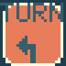

TURN：左折

WAIT 2

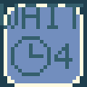

WAIT 4

WAIT 6

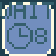

WAIT 8

EMPTY：何も置かず、進行方向を保ちます。そこに元からある仕掛けの効果は消えません。

TURN RIGHT／TURN LEFT：入ってきた向きから見て右／左へ90度曲がります。画面の右・左という意味ではありません。二匹とも同じ指示を受け、再び踏めば再び曲がります。

WAIT 2／4／6／8：表示された長さだけその場で待ち、その後は同じ方向へ進みます。秒数ではありません。踏み直すたびに待つため、一度しか使わない砂時計とは異なります。

以下に説明する箱、PAD、扉、ALTなどは、ステージに置かれた仕掛けです。プレイヤーが選んで配置するチップではありません。

## 前進・立ち止まり・二匹の特技

ネコが押す箱

通れない岩

指示や仕掛けで方向が変わらない限り前進します。道の先がない、閉じた扉、相手がいるなどの場合は手前で止まり、条件が変われば進めます。行き止まりで自動的に曲がることはありません。

ネコは前の箱を押せます。引くこと、箱を二つまとめて押すことはできません。押し先には空きが必要で、扉やスイッチなど任意の仕掛けの上へ押せるわけではありません。ウサギは箱を押せませんが、HOPの小さな穴を一つ飛び越せます。着地点には通れる道と空きが必要です。飛び越えた場所の指示は踏まず、着地点の指示を受けます。

## 穴・橋・崩れる床

小さな穴：HOP

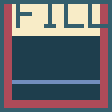

大きな穴：FILL

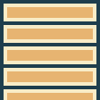

箱で作る橋

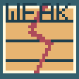

離れると崩れる床

### 離れると穴になる

仲間が離れる

離れると崩れる床

→

小さな穴：HOP

### 箱を使って橋にする

ネコが箱を押し込む

大きな穴：FILL

→

箱で作る橋

HOP：ウサギが飛び越せる小さな穴。ネコはそのまま通れません。

FILL：大きな穴。ウサギも飛び越せません。ネコが箱をHOPまたはFILLへ押し込むと橋になり、二匹とも渡れます。箱は材料として消費され、取り出したり重しとして再利用したりできません。

崩れる床：乗った瞬間ではなく、そこから離れたときにHOPの穴になります。最初に通る仲間と、後から通る仲間で条件が変わります。

## OPENと同じ色の扉

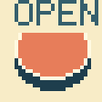

赤OPEN

赤い扉

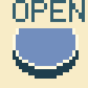

青OPEN

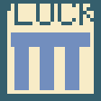

青い扉

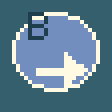

青OPEN＋右向き

赤／青のOPENを踏むと、同じ色の扉が開きます。離れても開いたままで、もう一度踏んでも閉じません。赤と青は独立しています。再挑戦すると初期状態に戻ります。矢印付きの仕掛けは、開錠などの効果に加えて矢印の向きへ進路を変えます。

## PADと重さで開く扉

空のPAD

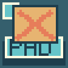

箱が乗ったPAD

A：重し1つ以上

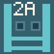

2A：重し2つ以上

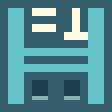

=1：ちょうど1つ

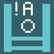

!A：重しなし

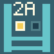

2A：1つ点灯・閉

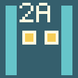

2A：2つ点灯・開

### 2A扉の点灯と開閉

重しが1つ増える

2A：重し2つ以上

→

2A：1つ点灯・閉

→

2A：2つ点灯・開

### =1扉は重しが多すぎても閉じる

重しが1つ増える

=1：ちょうど1つ

→

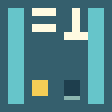

重し1つ：開

→

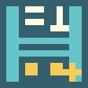

重し2つ以上：閉

PADは仲間または箱が乗っている間、重し一つとして数えます。通り過ぎた回数ではなく、現在押されているPADの数を見ます。箱を残せば仲間が離れても重さを維持できます。

通常のPAD扉：一つ以上の重しで開きます。DUAL：二つ以上で開きます。=1：ちょうど一つだけで開き、二つ以上では閉じます。重しなしで開く逆条件の扉：すべてのPADが空いたときだけ開きます。

扉の点灯表示を見て、必要な数と現在の状態を確認しましょう。通過を始めた仲間は途中で条件が変わっても通り抜けます。その通過が終わるまでは扉が開いた表示を保ちます。一定時間だけ開くタイマーではありません。

## SWAP・ON／OFF・ONE

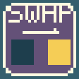

SWAP：毎回切替

ONで通れる扉

OFFで通れる扉

ONE：未使用

ONE：使用済み

### ONEは初回だけ切り替える

初回は切替／以降は変化なし

ONE：未使用

→

ONE：使用済み

→

ONE：使用済み

SWAPを踏み直すたびに、共通のON／OFF状態が切り替わります。ON扉はONで、OFF扉はOFFで通れます。一方を開ける変更が、もう一方を閉じることになります。この状態はOPENの赤・青とは別です。

ONEは同じ状態を一度だけ切り替えます。その後は使用済みとなり、誰が踏み直しても切り替えません。SWAPが複数あっても、それぞれ別の状態を持つわけではありません。再挑戦で初期状態と未使用状態へ戻ります。

## 進路を変える固定床

固定の右向き矢印

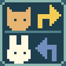

ネコ右折・ウサギ左折

ネコ専用FLIP

連動床：右

連動床：下

### FLIPで連動する床の表示が変わる

ネコがFLIPを踏み直す

連動床：右

→

連動床：下

→

連動床：右

固定矢印は画面上の矢印方向へ向きを変えます。TURNの相対的な右左とは別です。

ネコ／ウサギで分かれる床：ネコは右折、ウサギは左折します。どちらも入ってきた向きが基準です。

FLIP：ネコが踏み直すたびに、連動する方向床の向きを右／下に切り替えます。ウサギがFLIPを踏んでも切り替わりません。方向床は、到着時の表示に従って進ませます。

## ALTとCYC：訪問順で変わる床

ALT ①右折

ALT ②左折 → ①へ

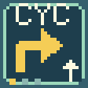

CYC ①右折

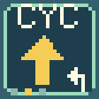

CYC ②直進

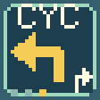

CYC ③左折 → ①へ

### ALT：次の訪問に向けて交互に変化

到着した仲間に現在の指示を出し、次へ

ALT ①右折

→

ALT ②左折 → ①へ

→

ALT ①右折

### CYC：三段階を繰り返す

到着した仲間に現在の指示を出し、次へ

CYC ①右折

→

CYC ②直進

→

CYC ③左折 → ①へ

→

CYC ①右折

ALTは右折→左折→右折…と交互に変化します。CYCは右折→直進→左折→右折…の三段階です。最初の状態は面の表示を確認してください。

到着した仲間はその時点の指示を受け、床は次の訪問者向けの表示へ変わります。表示の変化を、今乗っている仲間の指示と取り違えないようにしましょう。二匹で状態を共有し、同じ仲間の再訪でも進みます。立ち止まっているだけでは次段階へ進みません。右左は進行方向が基準です。

## 一度きりの砂時計とロケット

砂時計：一度だけ待機

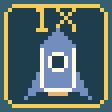

ロケット：未使用

ロケット：使用済み

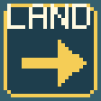

LAND：右向きに着地

### 砂時計：待機効果は最初の一匹だけ

初回にWAIT 4相当の待機を与え、通常床へ

砂時計：一度だけ待機

→

通常の床

### ロケット：移動後は使用済み

LANDへの移動に使う

ロケット：未使用

→

ロケット：使用済み

砂時計：最初に到着した仲間をWAIT 4相当だけ待たせ、その場所は通常の床になります。後から来た仲間は待ちません。配置するWAITチップは毎回効くため、同じものではありません。

ロケット：ネコもウサギも利用できます。対応するLANDへ一度だけ移動し、着地後は右向きになります。着地点が相手に使われている場合は空くまで待ちます。使用後のロケットでは再び移動できません。Expert版のロケットは単なる風景ではありません。再挑戦で砂時計もロケットも未使用に戻ります。

## 困ったとき

曲がらない：画面の左右ではなく進行方向基準か、飛び越して踏んでいない場所ではないか確認します。扉が閉じる：OPENとPADとON／OFFは別の仕組みです。戻って来ると違う：ALT、CYC、ONE、崩れる床などの使用履歴を確認します。見失った：F5全体表示でEnterを押して止め、二匹の位置と仕掛けを確認できます。

このマニュアルは開発中のExpert版専用です。ノーマル版の操作・仕掛けと混同しないでください。実機での動作確認完了を示すものではありません。面ごとの解法やパスワード一覧は掲載していません。

## チップに重なる小さな状態表示

青OPEN：押す前

青OPEN：押した後

ONE：未使用

OFF：ONE使用済み

PAD：重しなし

PAD：重しあり

### 青OPENの状態表示

踏むと押された形へ変わる

青OPEN：押す前

→

青OPEN：押した後

### ONEの状態表示

一度切り替えると使用済みになる

ONE：未使用

→

OFF：ONE使用済み

### PADの状態表示

重しが乗ると点灯。離れると元に戻る

PAD：重しなし

→

PAD：重しあり

TURNやWAITの下に仕掛けがある場合、チップの下端に小さな絵と文字で仕掛けと現在の状態を表示します。これは配置できるチップの種類ではありません。チップを置いても、下の仕掛けは残ります。

画像で「0B」のように見える印は、数字の0ではなく、青いOPENボタンの絵とB（Blue）です。踏む前と後でボタンの形が変わります。

「1ONE」のように見える印は、丸の中の1とONEです。一度だけ共有ON／OFF状態を切り替える仕掛けが未使用であることを表します。使用後はチェック印とOFFになります。このOFFはONEの使用済みを示し、共有状態がOFFという意味ではありません。

PADの印は重しが乗ると点灯し、離れると元に戻ります。小さな印も元の仕掛けと同じ状態を示します。
